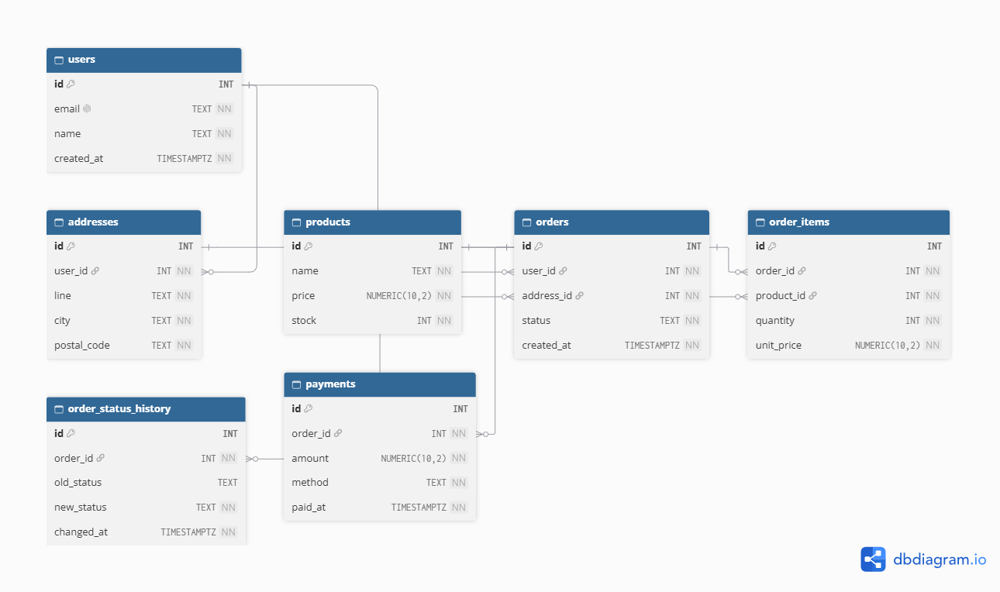

# Order Fulfillment Schema

ERD: https://dbdiagram.io/d/6b0057d35cb51eed0751e839

To run it, create an empty Postgres database and run: psql -U postgres -d orders_test -f schema.sql. The file starts with DROP TABLE IF EXISTS lines, so it can be run again safely.

## What it does

This subsystem handles everything after a customer checks out. It stores customers and their addresses, the products for sale, the orders placed, the products inside each order, every status change an order goes through (pending, paid, packed, shipped, delivered, cancelled) and the payments made.

## Tables

users stores one row per customer, with a unique email. addresses stores shipping addresses, and it is separate because one user can have many addresses. products is the catalogue with price and stock. orders has one row per checkout and holds the user, the address, the current status and the time. order_items has one row per product in an order, with quantity and unit price. It is separate because an order has many products and a product appears in many orders. order_status_history has one row per status change, so we keep the full history and not only the latest status. payments stores money received for an order, separate because an order can have more than one payment and payments have their own lifecycle.

## Relationships

addresses.user_id points to users.id because an address belongs to one user, and deleting a user deletes their addresses. orders.user_id points to users.id because every order is placed by a customer, and RESTRICT stops a user with orders from being deleted. orders.address_id points to addresses.id to record where the order ships, and RESTRICT stops an address in use from being deleted. order_items.order_id points to orders.id to link each item to its order, and items are deleted with the order. order_items.product_id points to products.id to record what was bought, and RESTRICT keeps sold products in the catalogue. order_status_history.order_id points to orders.id so each change belongs to an order. payments.order_id points to orders.id so each payment belongs to the order it pays for, and RESTRICT keeps financial records from disappearing.

## Tradeoff

I store a copy of the price in order_items.unit_price at the time of purchase instead of reading products.price later. The alternative I rejected was leaving the price out of order_items and joining to products every time. That avoids duplicated data, but prices change over time, so an old order would show today's price and its total would be wrong. The cost is a little duplicated data, which I accept because an order is a historical record. I also used TEXT with CHECK constraints for status and payment method instead of enum types, because adding a new status is then a one-line change.

## Indexing and normalisation

Postgres indexes primary keys and unique columns automatically, but not foreign keys, so I added indexes on addresses(user_id), orders(user_id), orders(address_id), order_items(product_id) and payments(order_id) so joins and deletes do not scan whole tables. I added orders(status) for queries like all packed orders, orders(created_at) for date queries, and a composite index on order_status_history(order_id, changed_at) so one order's history is read in time order. order_items(order_id) needs no separate index because the UNIQUE (order_id, product_id) constraint already creates one that starts with order_id.

The design is in third normal form (3NF): every column depends on its table's key, and repeating groups (items, addresses, status changes, payments) are in their own tables. The two deliberate exceptions are order_items.unit_price, explained above, and orders.status, which repeats the latest row of order_status_history so the current state can be read without a lookup.